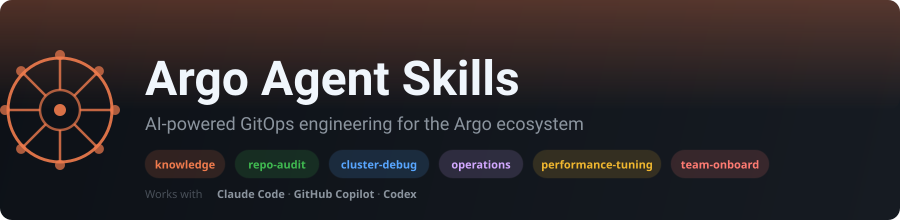
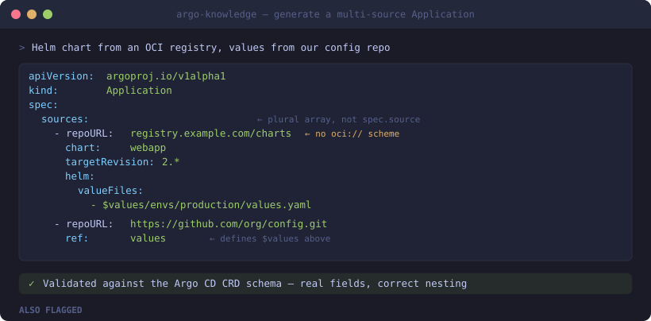
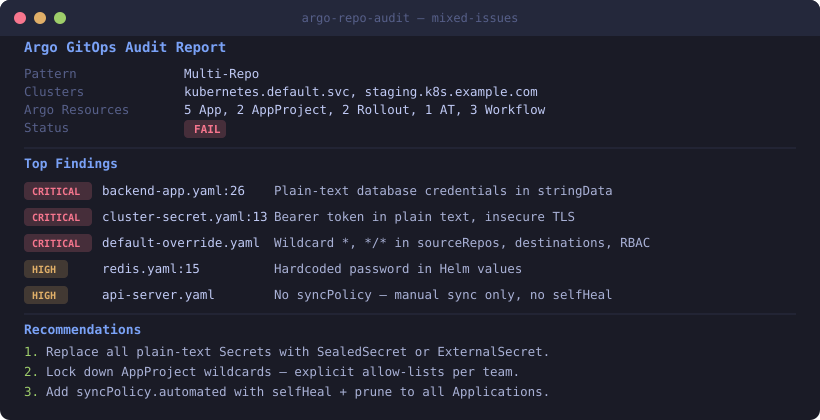
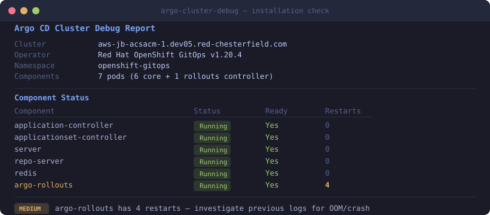
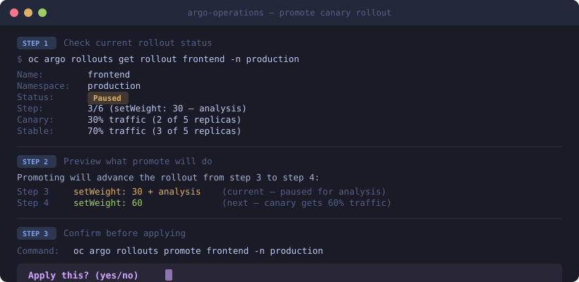
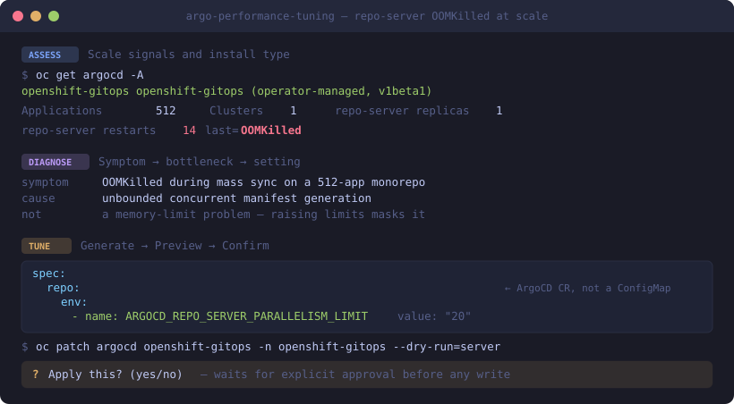
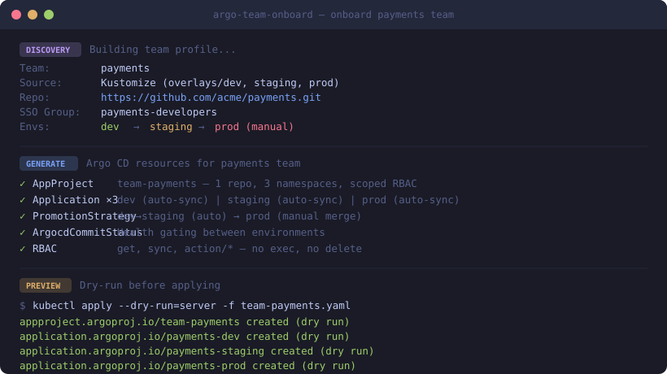

<p align="center">
  
</p>

<p align="center">
  <a href="LICENSE"></a>
  <a href="CONTRIBUTING.md"></a>
  
  
  
  
  
</p>

<p align="center">
  <b>Give your AI agent deep expertise in Red Hat OpenShift GitOps.</b><br>
  Argo CD and Argo Rollouts as the operator ships them — generate manifests, audit repos,
  debug clusters, tune performance, onboard teams, and manage operations from your terminal.
</p>

---

> **Scope — Red Hat OpenShift GitOps.** These skills cover Argo CD and Argo Rollouts as
> shipped and supported by the OpenShift GitOps operator, including the operator-managed
> CRDs (`ArgoCD`, `RolloutManager`, `NotificationsConfiguration`, `NamespaceManagement`,
> `ImageUpdater`). They work against vanilla Argo CD too, but OpenShift GitOps is the
> target.
>
> **Argo Workflows and Argo Events are deliberately out of scope** — they are separate
> upstream projects the operator does not ship, and on OpenShift pipelines are normally
> [OpenShift Pipelines](https://docs.redhat.com/en/documentation/openshift_pipelines)
> (Tekton). For those, see the [Argo Workflows](https://argo-workflows.readthedocs.io/)
> and [Argo Events](https://argoproj.github.io/argo-events/) docs.
>
> [GitOps Promoter](https://github.com/argoproj-labs/gitops-promoter) **is** covered for
> environment promotion, but is installed separately — it is argoproj-labs, not
> operator-owned.

<details>
<summary><b>Quick Start</b></summary>

```shell
# Claude Code
/plugin marketplace add alimobrem/argo-skills
/plugin install argo-skills@argocd

# Then try:
# "Audit the current repo for GitOps best practices"
# "Check if Argo CD is healthy on my cluster"
# "Generate an ApplicationSet with git directory generator"
```

</details>

## Install

<details>
<summary><b>Claude Code</b></summary>

```shell
/plugin marketplace add alimobrem/argo-skills
/plugin install argo-skills@argocd
```

After install, the `argocd` agent appears in `/agents` and the 6 skills auto-trigger
based on context. Run `/reload-plugins` if they don't appear immediately.

</details>

<details>
<summary><b>Codex</b></summary>

Add to `$REPO_ROOT/.agents/plugins/marketplace.json` or `~/.agents/plugins/marketplace.json`:

```json
{
  "name": "argo-skills",
  "category": "Developer Tools",
  "source": {
    "source": "url",
    "url": "https://github.com/alimobrem/argo-skills.git",
    "ref": "main"
  },
  "policy": {
    "installation": "AVAILABLE",
    "authentication": "ON_INSTALL"
  }
}
```

</details>

<details>
<summary><b>GitHub Copilot</b></summary>

Copy the agent file to your repository:

```shell
mkdir -p .github/copilot
cp agents/github-copilot/argocd.agent.md .github/copilot/
```

</details>

<details>
<summary><b>Prerequisites</b></summary>

Required:
- `kubectl` or `oc` for Kubernetes/OpenShift cluster interaction

Optional (enhances capabilities):
- `kustomize` — Kustomize overlay builds
- `kubeconform` — schema validation against Argo CRDs
- `yq` — YAML parsing
- `argocd` — richer Application debugging and sync operations
- `kubectl-argo-rollouts` — Rollout status and promotion

Install all on macOS:
```shell
brew bundle
```

</details>

## Usage Guide

> **Full guide with all example prompts:** [docs/USER_GUIDE.md](docs/USER_GUIDE.md)

### How the Skills Work Together

The agent automatically selects the right skill based on what you ask:

```
 Ask a question ────► argo-knowledge           "How do I...?"
 Audit a repo ──────► argo-repo-audit          "Audit this repo"
 Debug a cluster ───► argo-cluster-debug       "Why is X failing?"
 Make a change ─────► argo-operations          "Install / create / promote / upgrade..."
 Tune performance ──► argo-performance-tuning  "Why is this slow at scale?"
 Onboard a team ────► argo-team-onboard        "Set up a new team on Argo CD"
```

You don't need to invoke skills manually — just describe what you need.

### Knowledge — Ask Questions & Generate YAML

<p align="center">
  
</p>

Use when you need to understand OpenShift GitOps concepts or generate manifests.

```text
# Generate manifests
Generate a multi-source Application that combines a Helm chart from
oci://registry.example.com/myapp with values from a Git repo.

# Architecture guidance
What's the best way to structure a multi-cluster GitOps repo?
Should I use app-of-apps or ApplicationSet?

# Newer features
How do I set up argocd-agent for 200 edge clusters behind firewalls?
How do I run Applications in any namespace for multi-tenancy?

# OpenShift-specific
Generate an ArgoCD CR for the OpenShift GitOps operator with OAuth and Routes.
```

<details>
<summary>Reference docs included</summary>

| Topic | Reference |
|-------|-----------|
| Application spec, sync policies, health checks, multi-cluster | `applications.md` |
| ApplicationSet generators, progressive syncs, templates | `applicationsets.md` |
| AppProject RBAC, source/destination restrictions, sync windows | `app-projects.md` |
| Rollout canary/blue-green, traffic management, AnalysisTemplate | `rollouts.md` |
| Notification services, templates, triggers, subscriptions | `notifications.md` |
| Image updater annotations, strategies, write-back | `image-updater.md` |
| Repository patterns (app-of-apps, ApplicationSet, monorepo) | `repo-patterns.md` |
| Best practices (sync, RBAC, health, secrets) | `best-practices.md` |
| argocd-agent hub-and-spoke architecture | `agent-mode.md` |
| Multi-tenancy, apps-in-any-namespace, Autopilot | `multi-tenancy.md` |
| OpenShift GitOps Operator, ArgoCD CRD, Routes, SCCs, OAuth | `openshift.md` |
| **Operator-only CRDs** — RolloutManager, NotificationsConfiguration, NamespaceManagement, ImageUpdater, GitopsService | `openshift-gitops-operator.md` |
| GitOps Promoter, PromotionStrategy, branch-per-env promotion, commit status gating | `gitops-promoter.md` |

</details>

### Repo Audit — Security & Best Practice Review

<p align="center">
  
</p>

Use when you want to validate a GitOps repo before deploying or during a review.

```text
# Full audit
Audit the current repo and provide a GitOps report.

# Targeted checks
Check for security issues in my AppProject configurations.
Are there any hardcoded secrets in Helm values?
Do my Applications have proper sync retry configuration?

# Validation only
Just validate YAML syntax and schemas, don't do a full audit.
```

**What it catches:**

| Severity | Examples |
|----------|---------|
| Critical | Wildcard `*` in AppProject sourceRepos/destinations, plain-text Secrets, hardcoded passwords in Helm values, `clusterResourceWhitelist: */*` |
| Warning | Missing syncPolicy, `targetRevision: HEAD` in production, no retry/backoff, missing `ignoreDifferences` for controller-managed fields |
| Info | Missing `ignoreDifferences` for HPA-managed replicas, no progressive sync on multi-cluster ApplicationSets |

### Cluster Debug — Troubleshoot Live Issues

<p align="center">
  
</p>

Use when something is broken or you want a health check.

```text
# Health check
Check if Argo CD is properly installed on my cluster.

# Application issues
Why is my Application podinfo stuck in OutOfSync?
Debug the degraded Application in the production namespace.

# Rollout issues
The canary rollout for frontend is stuck at step 2. Why?
Are my AnalysisTemplates actually testing anything meaningful?

# Multi-tenant review
Compare all ArgoCD instances on this cluster and check for security gaps.

# Deep investigation
Inspect all Rollouts on this cluster and give me a health report.
Review the Argo CD configuration for security concerns.
```

### Operations — Install, Deploy, Promote, Maintain

<p align="center">
  
</p>

Use when you want to make changes. Every write follows a safety model:
**Generate** YAML → **Preview** with dry-run → **Confirm** before applying.

```text
# Setup
Install Argo CD on my OpenShift cluster using the GitOps operator.
Create an AppProject for the frontend team with restricted access.
Add the staging cluster to Argo CD.

# Deploy
Create an Application for my Helm chart with automated sync.
Create an ApplicationSet with git directory generator and progressive syncs.
Set up Slack notifications for sync failures.

# Promote
Promote the canary rollout frontend in production.
Sync the Application with server-side apply.
Abort the failing rollout and retry.

# Maintain
Upgrade Argo CD to the latest version.
Back up all my Applications and AppProjects to YAML files.
Rotate the Git credentials for the infra repo.
```

<details>
<summary>Safety model details</summary>

| Step | What happens |
|------|-------------|
| Generate | Produces YAML manifest or CLI command, shows it in a code block |
| Preview | Runs `--dry-run=client`, `kubectl diff`, or `argocd app diff` to show what changes |
| Confirm | Asks "Apply this? (yes/no)" — does NOT proceed without explicit approval |

Read-only operations (backup, status checks) skip confirmation.

Destructive operations (delete, prune, rollback) require typing the resource name to confirm.

</details>

### Performance Tuning — Diagnose & Fix Slowness at Scale

<p align="center">
  
</p>

Use when OpenShift GitOps is slow, resource-hungry, or struggling at scale.

```text
# Repo-server under pressure
Our argocd-repo-server keeps getting OOMKilled every time we push to our
  500-application monorepo.

# UI/controller sluggishness
The Argo CD UI feels sluggish and drift detection takes forever with 2,000 apps.

# Multi-cluster scaling
We have 20 clusters registered but only one application-controller pod and
  it's maxed out on CPU.

# Timeout errors
Users see "context deadline exceeded" opening an Application with a huge Helm chart.

# Git provider limits
Our GitHub org is rate-limiting us — 500 apps all point at the same repo and branch.

# Reconciliation churn (no real drift)
Our controller CPU is constantly high even though every Application shows
  Synced/Healthy — nothing in Git has changed.
```

Diagnoses the bottleneck first — including whether the controller is reconciling for the
right reasons at all (`resource.ignoreResourceUpdatesEnabled`, `resource.exclusions`,
per-Application `manifest-generate-paths` cache scoping for monorepos) before reaching for
repo-server concurrency, controller processors, sharding (static or Dynamic Cluster
Distribution), or Git rate-limits — then applies the same **Generate → Preview → Confirm**
safety model as Operations before changing anything live.

<details>
<summary>Reference docs included</summary>

| Topic | Reference |
|-------|-----------|
| Full settings table, per-setting fixes, sharding algorithms, standalone vs. OpenShift GitOps Operator YAML, common mistakes, tuning order of leverage | `tuning-settings.md` |

</details>

### Team Onboarding — Set Up New Teams on Argo CD

<p align="center">
  
</p>

Use when you need to onboard app teams onto Argo CD. The skill discovers what
each team already has (CI, registry, source type) and generates only the Argo CD
pieces — no assumptions about your stack.

**Onboarding output is a commit, not a `kubectl apply`.** The tenant boundary —
AppProject, RBAC, namespace, quotas, NetworkPolicies — is GitOps config like anything
else, so the skill writes it to your GitOps repo and hands off to Argo CD to reconcile.
Applying it directly would put the boundary outside Git: invisible in review, missing
from the audit trail, and reverted the next time anything reconciles. The only exception
is a one-time bootstrap when no control loop exists yet, and the skill names it as such.

The recommended model follows Thomas Jungbauer's
[project onboarding with GitOps and Helm](https://www.redhat.com/en/blog/project-onboarding-using-gitops-and-helm):
onboarding a tenant means adding one small `values.yaml`, which a shared onboarding chart
renders and an ApplicationSet discovers. Committing rendered manifests or Kustomize
overlays is also supported.

```text
# Single team onboarding
Onboard the payments team. They use Kustomize, deploy from
https://github.com/acme/payments.git, need dev/staging/prod namespaces.

# Helm-based team
Onboard analytics — they deploy a Helm chart from OCI registry
oci://registry.acme.com/charts/analytics with values in a separate config repo.

# Self-service at scale
Set up self-service onboarding so teams can add themselves via PR.

# Multi-environment with promotion
Onboard the checkout team with gitops-promoter gating dev → staging → prod.
Production should require manual approval.
```

**What it generates:**

| Resource | When | Why |
|----------|------|-----|
| AppProject | Always | Security boundary — scoped sourceRepos, destinations, RBAC |
| Application | Always | Points to team's repo with correct source type (Helm/Kustomize/directory) |
| RBAC role | Always | Project-scoped permissions for team's SSO group |
| Namespace | Always | With Pod Security Standards (`enforce: restricted`) and monitoring labels |
| NetworkPolicies | Always | Default-deny egress (with DNS allowed) plus router, monitoring, and same-namespace ingress — without these the namespace is open to every pod on the cluster |
| ResourceQuota + LimitRange | If needed | Capacity limits, via t-shirt size or explicit values |
| PromotionStrategy | If multi-env | Branch-per-environment promotion with health gates |
| ApplicationSet | If self-service | Per-tenant values discovered by a `**/values.yaml` git generator |

**What it refuses:**

| Request | Response |
|---------|----------|
| `sourceRepos: '*'` | Lists repos explicitly — wildcards defeat multi-tenancy |
| `clusterResourceWhitelist: '*/*'` | Scopes to specific CRD groups needed |
| `exec` permission | Redirects to kubectl exec with scoped RBAC |
| Hardcoded secrets | References ExternalSecret or SealedSecret patterns |
| "Just apply it to the cluster" | Explains the drift cost and offers the commit path; proceeds only if it's a genuine bootstrap, and commits the same manifests alongside |

<details>
<summary>Reference docs included</summary>

| Topic | Reference |
|-------|-----------|
| **Recommended model** — per-tenant values + onboarding chart, discovery ApplicationSet, t-shirt sizes, default NetworkPolicies, Pod Security Standards, two-instance split | `gitops-onboarding.md` |
| What gets created, AppProject/Application/RBAC templates, validation checklist | `onboarding-guide.md` |
| Self-service via ApplicationSet, PR workflow, guard rails | `self-service-pattern.md` |
| Helm/Kustomize/directory variants, Rollouts, notifications, sync windows, promoter | `onboarding-variants.md` |

</details>

## Benchmarks

Every skill is measured against an unaided baseline — the same model, same prompts, same
live OpenShift cluster, no access to `skills/`. 572 expectations per condition, graded
blind.

| Skill | with-skill | baseline | delta |
|-------|-----------:|---------:|------:|
| [`argo-performance-tuning`](benchmarks/argo-performance-tuning.md) | **94.2%** | 66.8% | **+27.4** |
| [`argo-repo-audit`](benchmarks/argo-repo-audit.md) | **97.5%** | 81.2% | **+16.2** |
| [`argo-operations`](benchmarks/argo-operations.md) | **93.8%** | 84.4% | **+9.4** |
| [`argo-knowledge`](benchmarks/argo-knowledge.md) | **98.5%** | 93.9% | +4.5 |
| [`argo-team-onboard`](benchmarks/argo-team-onboard.md) | 84.5% | 84.5% | **0.0** |
| [`argo-cluster-debug`](benchmarks/argo-cluster-debug.md) | 92.1% | 92.1% | **0.0** |
| **Weighted overall** | **93.6%** | **83.7%** | **+9.9** |

**The delta tracks how product-specific a skill is.** Performance tuning — exact setting
names, defaults the operator silently overrides, which CR field actually wins — gains
most. General Argo CD knowledge the model already has gains least.

**Two skills show no measurable benefit, and we publish that.** We also measured the
grader: regrading identical text moved scores up to 7 points, so treat anything under
~5 points as unresolved.

→ **[Methodology, grader-variance analysis, and caveats](benchmarks/README.md)** — read
before quoting any of these numbers.

## Contributing

Contributions are welcome! Please see [CONTRIBUTING.md](CONTRIBUTING.md) for guidelines.

<details>
<summary><b>Development</b></summary>

```shell
# Install prerequisites (macOS)
brew bundle

# Download Argo CRD schemas for validation (13 schemas, every in-scope kind)
make download-schemas

# Checks — all of these also run in CI
make test-discover        # discovery script against the test fixtures
make test-validate        # YAML syntax, schema validation, kustomize builds
make test-registration    # every skill registered in manifests, agent, banner, README, CI
make test-expectations    # eval expectations' field paths resolve against the CRD schemas

# Evals
make eval                 # all six skills
make eval-knowledge              # no cluster needed
make eval-repo-audit             # no cluster needed
make eval-cluster-debug          # needs a live cluster
make eval-operations             # needs a live cluster
make eval-performance-tuning     # needs a live cluster
make eval-team-onboard           # needs a live cluster
```

Two guards worth knowing about, because they catch the mistakes that actually happened here:

- **`make test-registration`** — a new skill cannot be added without being wired into the
  marketplace manifest, agent definition, Makefile eval targets, banner, README and eval
  workflow. The banner silently lagged two skills behind before this existed.
- **`make test-expectations`** — resolves every `spec.*` path asserted in an eval against
  the committed CRD schemas. Three expectations were found grading *for* manifests the API
  server rejects or prunes; this stops that recurring.

See [AGENTS.md](AGENTS.md) for the repo layout, skill conventions, and eval runner instructions.

</details>

## Code of Conduct

This project follows the [Contributor Covenant Code of Conduct](CODE_OF_CONDUCT.md).

## Security

See [SECURITY.md](SECURITY.md) for reporting vulnerabilities.

## License

[MIT License](LICENSE)
